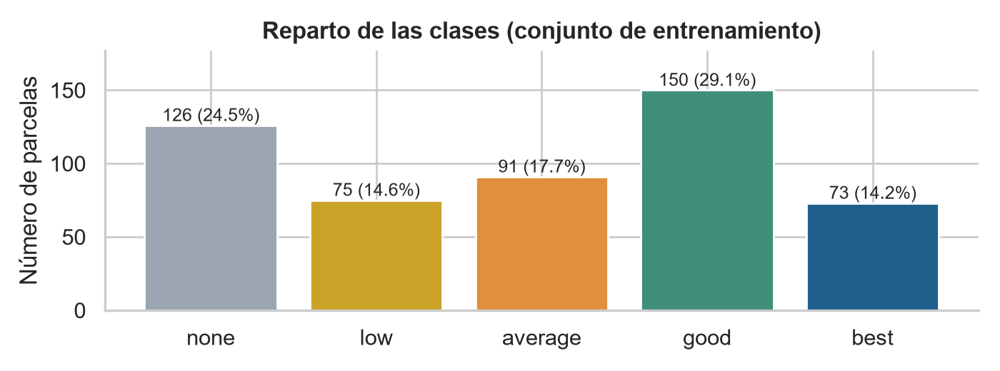
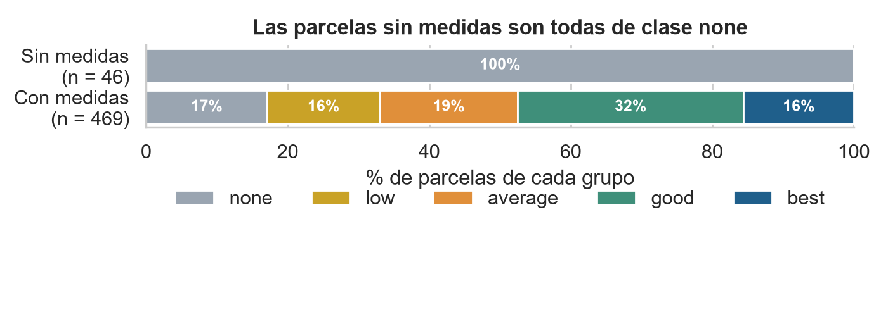
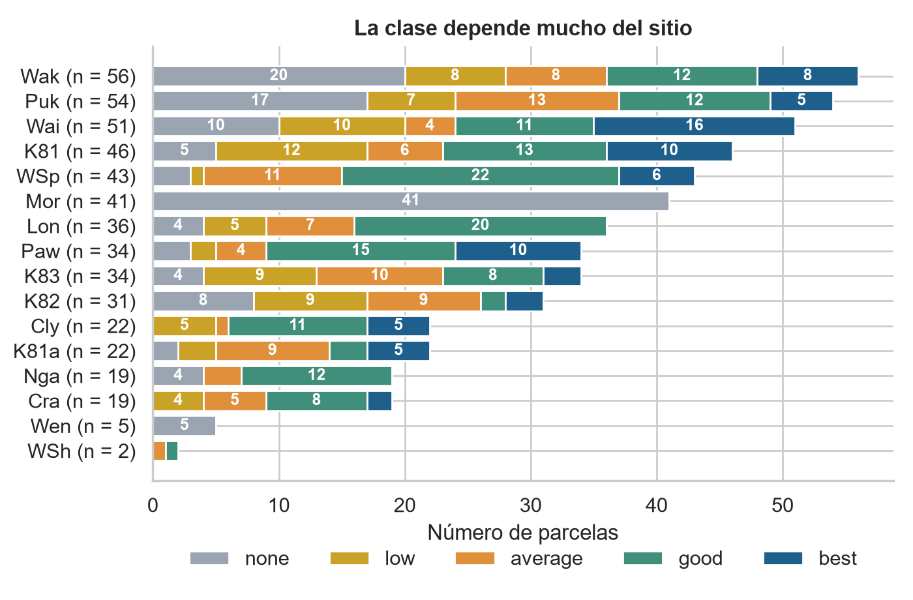
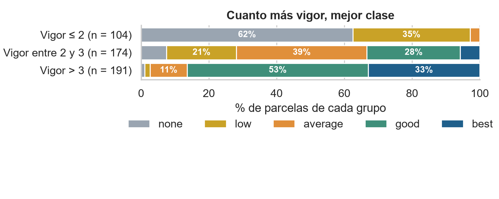

# ¿Qué nos dicen los datos de eucaliptos?

*Informe del análisis exploratorio · Proyecto de clasificación multiclase · 12 de noviembre de 2026*

## Resumen

Analizamos 515 parcelas de ensayo de eucalipto (el 70 % de las 736 disponibles) para preparar un modelo que prediga su **utilidad para la conservación del suelo**, en cinco niveles: **none, low, average, good y best**. Encontramos tres cosas que condicionan el modelo: las parcelas sin medidas son siempre de clase **none**, el **sitio** donde se plantó marca mucho la clase, y el **vigor** del árbol es la medida que más se parece a la clase. Además hay un error evidente en un dato de diámetro. Recomendamos **quitar del modelado las parcelas sin medidas** y tratar los demás puntos antes de entrenar, para comparar los modelos de forma justa.

## Contexto y datos

Los datos son del estudio Eucalyptus Soil Conservation (Bruce Bulloch, colección WEKA, OpenML): 736 parcelas de ensayo en colinas de clima estacionalmente seco de la Isla Norte de Nueva Zelanda. Cada fila es una parcela, con 19 características (sitio, clima, especie, tamaño, supervivencia, vigor y forma del árbol) y la clase de utilidad, que va de none (la peor) a best (la mejor).

Para no contaminar la evaluación, apartamos antes de mirar nada un 15 % de las parcelas para la prueba final y otro 15 % para validar; este informe usa solo el 70 % restante. **Límite principal:** los métodos de ensayo cambiaron con el tiempo y faltan medidas en algunos sitios, así que los resultados describen estos ensayos, no todos los eucaliptos.

*Cómo leerlo: cada barra es una clase; good es la más frecuente (29,1 %) y best la menos (14,2 %). No hay una clase dominante.*

## Hallazgos

### 1. Las parcelas sin medidas son todas de clase none

46 parcelas no tienen ninguna medida de vigor, forma ni resistencia a insectos (todo el sitio **Mor** con 41 y todo el sitio **Wen** con 5). Las 46 son de clase none (46 de 46), frente al 17 % de none entre las otras 469. Según la descripción del estudio, es probable que las plantas murieran o no se midieran.

Estas 46 parcelas son el 37 % de la clase none en entrenamiento (46 de 126). Si se quitan, none pasa del 24,5 % (126 de 515) al 17,1 % (80 de 469) y las clases quedan más parejas; en cambio, la relación del vigor con la clase no cambia, porque esas parcelas no tenían vigor.

*Cómo leerlo: la barra de arriba son las parcelas sin medidas (todas none); la de abajo, las que sí las tienen. Atención: si el modelo aprende que «no hay medidas = none», parecerá más acertado de lo que será con datos nuevos que sí traigan medidas (a esto se le llama fuga de información).*

### 2. El sitio marca mucho la clase

Hay 16 sitios y su resultado es muy distinto: en **Lon** 20 de 36 parcelas son good y ninguna best, y en **Wak** 20 de 56 son none. Además, siete columnas (localidad, mapa, latitud, altitud, lluvia, heladas y año) toman un único valor por sitio, es decir, describen el mismo dato de siete formas.

*Cómo leerlo: cada barra es un sitio y sus colores son las clases. Atención: Wen (5 parcelas) y WSh (2) son demasiado pequeños para sacar conclusiones. Si parcelas del mismo sitio quedan repartidas entre entrenamiento y validación, las métricas pueden salir infladas.*

### 3. El vigor es la medida que más se parece a la clase

De las 191 parcelas con vigor mayor que 3, 165 (86 %) son good o best; de las 104 con vigor 2 o menos, ninguna (0 de 104), y 65 son none. Las demás medidas se parecen menos a la clase: resistencia a insectos y forma del tallo, altura y diámetro.

*Cómo leerlo: cada barra es un grupo de parcelas según su vigor; los colores son las clases. Atención: es una asociación, no una causa; hay que confirmar que el vigor estará disponible cuando se use el modelo.*

### 4. Calidad de los datos

- No hay filas duplicadas.
- **Un error evidente:** una parcela del sitio Paw tiene un diámetro de 42 085 cm; el siguiente valor más alto es 53,86 cm en las otras 514.
- La supervivencia falta en 22 parcelas del sitio Cly (sin relación con la clase) y el número de lote falta en 5.
- Altura y diámetro miden el tamaño y se parecen mucho entre sí; las tres puntuaciones de forma (tallo, copa y ramas) también.

## Qué significa y qué recomendamos

- **Quitar del modelado las parcelas sin medidas** (hallazgo 1), con la misma regla en entrenamiento, validación y prueba, para no premiar al modelo por «adivinar» la ausencia. El modelo solo valdría para parcelas con medidas: una parcela sin medidas se trataría fuera del modelo con una regla simple, y habría que decirlo en la aplicación. Como cada integrante prepara sus datos por su cuenta, esta regla debe acordarse entre todos; si no, los modelos no son comparables.
- **Validar teniendo en cuenta el sitio** (hallazgo 2): acordar si la validación agrupa las parcelas por sitio, y reducir las siete columnas repetidas.
- **Confirmar que el vigor y las demás medidas existirán al predecir** (hallazgo 3); si no, el modelo no será utilizable.
- **Corregir o descartar el diámetro erróneo** y revisar los datos sin valor (hallazgo 4).
- **Medir con la misma vara:** todos los modelos con el mismo reparto de datos, la misma validación y las mismas métricas (acierto global y F1 medio de las cinco clases), y la prueba final solo una vez al elegir el modelo.

## Límites y próximos pasos

- Solo se analizó el 70 % de las parcelas (515 de 736), sin preparar todavía los datos; el preparado lo hace cada integrante antes de entrenar su modelo.
- Hay grupos pequeños (sitios con 2 y 5 parcelas) que no permiten conclusiones propias.
- Las relaciones descritas son asociaciones, no causas, y los métodos de ensayo cambiaron con el tiempo.
- Siguiente paso: preparar los datos, entrenar los modelos de cada integrante, compararlos y elegir uno; entonces se añadirá el informe técnico con las métricas.
