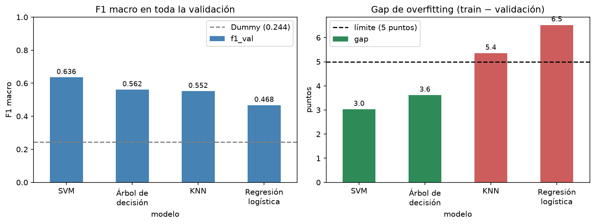
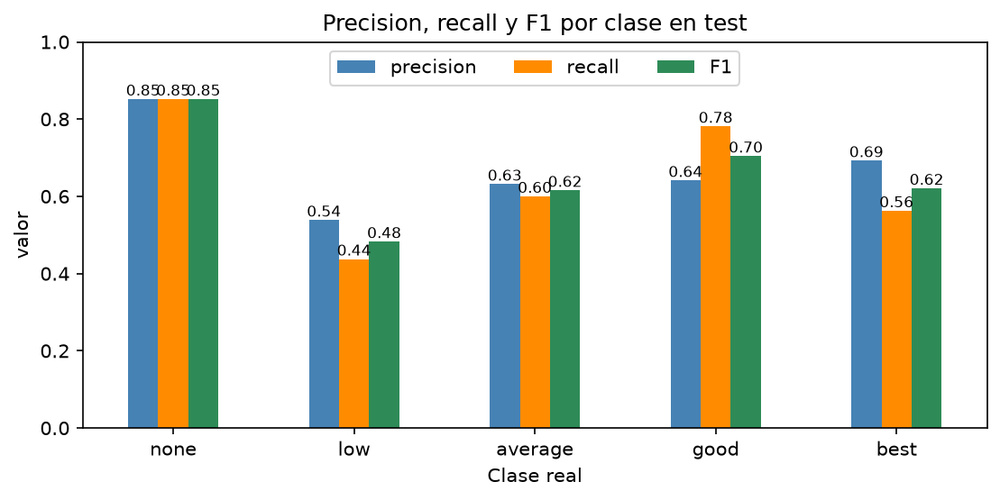
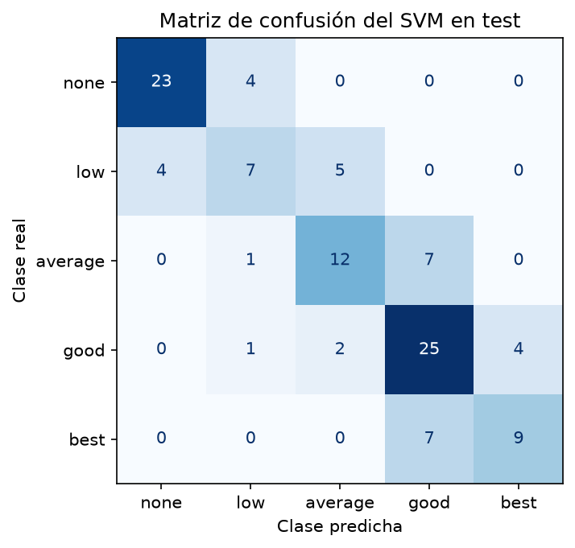
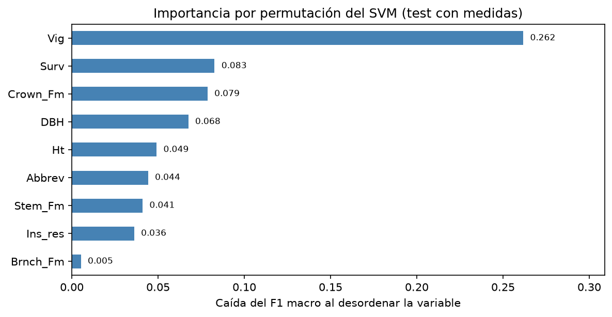

# Informe técnico: modelo de utilidad de parcelas de eucalipto

*Informe técnico del modelo ganador · Proyecto de clasificación multiclase · 17 de noviembre de 2026 · Historia #46*

## Resumen

El modelo elegido es un **SVM lineal** (`C = 0.045`) que predice la utilidad de una parcela de eucalipto en cinco clases ordenadas: `none` < `low` < `average` < `good` < `best`. En el conjunto de **test**, que solo se abrió una vez y solo para este modelo, obtiene un **F1 macro de 0.655** y una **accuracy global de 0.685** (0.660 si se miran solo las parcelas con medidas). Supera al Dummy de referencia en **47 puntos** de F1 macro.

El **overfitting está controlado**: el gap entre train y validación con medidas es de **3.0 puntos**, por debajo del límite de 5, y en test es de **−1.1 puntos**. El modelo acierta o se queda a una clase de distancia en 110 de las 111 parcelas de test: solo comete **un error grave** de las cinco clases. Su punto débil es distinguir `best` de `good` y detectar `low`; su límite principal es que **rinde peor en sitios que no ha visto**. Todos los números de este informe salen de `06_conclusiones.ipynb`, que se apoya en `comun.py` y en el pipeline guardado `models/04_svm.joblib`.

## 1. Problema y datos

Los datos son del estudio *Eucalyptus Soil Conservation* ([OpenML 188](https://www.openml.org/d/188)): 736 parcelas de ensayo en la Isla Norte de Nueva Zelanda, con 19 características (sitio, clima, especie, tamaño, supervivencia, vigor y forma del árbol) y la clase de utilidad para conservar el suelo. Las cinco clases están ordenadas de peor a mejor: `none`, `low`, `average`, `good` y `best`.

El reparto es estratificado **70/15/15** con `SEMILLA = 42`: 515 parcelas para entrenar, 110 para validar y 111 para test. Al entrenamiento se le quitan las **46 parcelas sin medidas** (los sitios Mor y Wen), tal como acordó el equipo en el [ADR-0001](adr/0001-excluir-parcelas-sin-medidas.md), así que el modelo aprende con **469 parcelas**. Validación y test las conservan; esas parcelas no pasan por el modelo, se predicen `none` con una regla fija.

**Límite de los datos:** son ensayos antiguos de una región concreta, con pocas parcelas por sitio y clases desbalanceadas (`good` es la más frecuente, con 32 de 111 en test). Los resultados describen estos ensayos, no todos los eucaliptos del mundo.

## 2. Cómo se evalúa

El protocolo está fijado en [docs/acuerdos.md](acuerdos.md) y es el mismo para los cuatro modelos:

| Decisión | Regla |
|---|---|
| Métrica principal | **F1 macro**, que trata igual las cinco clases aunque `good` sea la más frecuente |
| Métrica del enunciado | **Accuracy** global, que se informa pero no decide |
| Validación | `StratifiedKFold` de 5 folds en train; aparte, `StratifiedGroupKFold` **por sitio** ([ADR-0002](adr/0002-stratifiedkfold-con-chequeo-por-sitio.md)) |
| Parcelas sin medidas | Fuera del entrenamiento; en validación, test y app se predicen `none` por regla |
| Overfitting | gap = (F1 train − F1 validación con medidas) × 100, **con signo**; debe ser **menor de 5 puntos** |
| Modelo ganador | El de mayor F1 macro en **toda la validación** entre los que cumplen el gap |
| Test | Se usa **una sola vez**, en `06_conclusiones`, y solo con el ganador |

El **pipeline** del ganador incluye todo el preprocesado, ajustado solo con train:

- numéricas (`DBH`, `Ht`, `Surv`, `Vig`, `Ins_res`, `Stem_Fm`, `Crown_Fm`, `Brnch_Fm`): imputación de la mediana y estandarización;
- categórica (`Abbrev`, el sitio): imputación de la moda y one-hot con `handle_unknown="ignore"`;
- modelo: `SVC(kernel="linear", C=0.045)`.

Se excluyeron `Rep` y `PMCno` por ser identificadores y `Sp` (especie) porque tiene 25 valores, muchos con dos o tres parcelas, y añadía sobreajuste sin mejorar la validación cruzada.

## 3. Comparación de modelos y elección del ganador

Los cuatro modelos se entrenaron en sus notebooks con los mismos datos, la misma validación y la misma evaluación. La tabla resume sus cifras en validación:

| Modelo | F1 val (toda) | F1 val (con medidas) | Accuracy val | F1 train | Gap (puntos) | Cumple gap |
|---|---|---|---|---|---|---|
| **SVM** | **0.636** | **0.601** | **0.709** | 0.631 | **3.0** | ✅ |
| Árbol de decisión | 0.562 | 0.520 | 0.636 | 0.557 | 3.6 | ✅ |
| KNN | 0.552 | 0.524 | 0.645 | 0.578 | 5.4 | ❌ |
| Regresión logística | 0.468 | 0.429 | 0.509 | 0.494 | 6.5 | ❌ |
| Dummy (referencia) | 0.244 | 0.101 | 0.427 | — | — | — |

*Cómo leerlo: a la izquierda, cuanto más alta la barra mejor, y todas tienen que quedar por encima de la línea gris del Dummy. A la derecha, las barras verdes cumplen el límite de 5 puntos y las rojas se pasan. El SVM es el más alto y cumple.*

Aplicando la regla acordada —mayor F1 en toda la validación **entre los que cumplen el gap**—, el ganador es el **SVM** (0.636). El árbol también cumple, pero queda 7.4 puntos por debajo. El KNN (5.4) y la regresión logística (6.5) se pasan del límite.

**Una precaución escrita antes de ver el test:** en validación cruzada el SVM varía mucho entre folds (0.582 ± 0.085), mientras que el árbol es más estable (0.565 ± 0.025). La diferencia entre ambos en CV (1.7 puntos) es menor que esa variación, así que la ventaja del SVM está clara en la validación pero no es segura en cualquier muestra. La regla del equipo decide por la validación y el test solo informa.

## 4. Overfitting: train frente a validación y test

| Conjunto | F1 macro | Accuracy |
|---|---|---|
| Train (469 parcelas) | 0.631 | 0.657 |
| Validación, toda (110) | 0.636 | 0.709 |
| Validación, solo con medidas (102) | 0.601 | 0.663 |
| Test, todo (111) | 0.655 | 0.685 |
| Test, solo con medidas (103) | 0.643 | 0.660 |

- **Gap en validación:** (0.631 − 0.601) × 100 = **3.0 puntos** → ✅ por debajo de 5.
- **Gap en test:** (0.631 − 0.643) × 100 = **−1.1 puntos** → ✅ (test sale incluso algo por encima de train; es ruido de una muestra de ~110 parcelas).
- **Validación cruzada:** 0.582 ± 0.085; **por sitio:** 0.507 ± 0.108.

El test no cae respecto a la validación, así que no hay señales de fuga de datos ni de sobreajuste a la validación. La conclusión es que el modelo generaliza: su F1 esperable en producción está entre **0.60 y 0.65**.

## 5. Accuracy global en test

El modelo acierta la clase exacta en **76 de las 111 parcelas de test**, es decir, una **accuracy de 0.685** (0.660 solo con medidas). La accuracy balanceada, que pesa igual las cinco clases, es 0.647 (0.634 con medidas): algo más baja porque `good` es la clase más frecuente y es también la que más se acierta.

Como referencia, el Dummy que responde siempre `good` (y `none` a las parcelas sin medidas) obtiene en test un F1 macro de 0.186 y una accuracy de 0.360. El SVM lo supera en **46.9 puntos** de F1 (54.8 puntos solo con medidas).

## 6. Precision, recall y F1 por clase

Métricas del SVM en **todo el test** (incluye las 8 parcelas sin medidas, resueltas por la regla `none`):

| Clase | Precision | Recall | F1 | Soporte |
|---|---|---|---|---|
| `none` | 0.85 | 0.85 | **0.85** | 27 |
| `low` | 0.54 | 0.44 | **0.48** | 16 |
| `average` | 0.63 | 0.60 | **0.62** | 20 |
| `good` | 0.64 | 0.78 | **0.70** | 32 |
| `best` | 0.69 | 0.56 | **0.62** | 16 |
| **Media macro** | **0.67** | **0.65** | **0.655** | 111 |

*Cómo leerlo: cada grupo de barras es una clase; azul es precision (de lo que predice esa clase, cuánto acierta), naranja es recall (de lo que realmente es esa clase, cuánto encuentra) y verde es F1 (el equilibrio de las dos). `none` es la mejor y `low` la peor.*

- **`none` (F1 0.85):** la más fácil. Las 8 parcelas sin medidas las acierta la regla, y de las 19 `none` con medidas acierta 15.
- **`good` (F1 0.70):** mucha precision y el mejor recall (0.78). Es la clase mayoritaria y el modelo tiende a ella cuando duda.
- **`average` y `best` (0.62):** nivel aceptable. `best` tiene buena precision (0.69) pero un recall de 0.56: se le escapan 7 de sus 16 parcelas, casi todas hacia `good`.
- **`low` (F1 0.48):** la más floja. Su recall es 0.44: **se le escapa más de la mitad** de las parcelas `low`, repartidas entre `average`, `none` y `good`.

En validación el orden es parecido: `none` la mejor (0.84), `best` la peor (0.40), y `low` se queda en 0.52. Que `best` suba en test (0.62) es variación de una muestra de 16 parcelas, no una mejora del modelo.

## 7. Matriz de confusión

*Cómo leerlo: cada fila es la clase real y cada columna la predicha. La diagonal son los aciertos (76 de 111) y lo que queda fuera son confusiones. Casi todo lo que sale de la diagonal cae en la casilla de al lado.*

| Real \ Predicha | `none` | `low` | `average` | `good` | `best` |
|---|---|---|---|---|---|
| `none` | **23** | 4 | 0 | 0 | 0 |
| `low` | 4 | **7** | 5 | 0 | 0 |
| `average` | 0 | 1 | **12** | 7 | 0 |
| `good` | 0 | 1 | 2 | **25** | 4 |
| `best` | 0 | 0 | 0 | 7 | **9** |

La matriz cuenta una historia muy clara:

- **Los errores son entre clases vecinas.** El modelo entiende la escala: no confunde `none` con `good` ni `best` con `none`.
- **`good` es el imán.** Recibe 7 `average` y 7 `best`, y a cambio solo cede 4 `good` hacia `best`. Cuando el modelo duda, se va a la clase más frecuente.
- **`low` es la zona difusa.** Se reparte entre `none` (4), `average` (5) y `good` (1): sus medidas se parecen a las de sus vecinas.
- **En la parte baja,** la regla de las parcelas sin medidas explica 8 de los 23 aciertos de `none`. Sin ellas, la matriz con medidas es idéntica salvo la fila `none` (15 aciertos y 4 confusiones con `low`).

## 8. Feature importance

La importancia se mide por **permutación** en las parcelas con medidas del test: se desordena una variable y se mide cuánto cae el F1 macro. Es la misma técnica que usó el SVM en su notebook, allí con validación.

*Cómo leerlo: cuanto más larga la barra, más se apoya el modelo en esa variable. Una barra casi nula significa que el modelo puede prescindir de ella sin perder acierto.*

| Variable | Importancia (caída del F1) |
|---|---|
| `Vig` (vigor) | **0.262** |
| `Surv` (supervivencia) | 0.083 |
| `Crown_Fm` (forma de la copa) | 0.079 |
| `DBH` (diámetro) | 0.068 |
| `Ht` (altura) | 0.049 |
| `Abbrev` (sitio) | 0.044 |
| `Stem_Fm` (forma del tallo) | 0.041 |
| `Ins_res` (resistencia a insectos) | 0.036 |
| `Brnch_Fm` (forma de las ramas) | 0.005 |

**El vigor es, con mucha diferencia, la variable que más pesa** (0.262): más del triple que la segunda. Lo siguen la supervivencia y la forma de la copa. El orden coincide con el de validación (`Vig` primero, 0.265, y `Surv` segundo), lo que indica que la interpretación es estable.

**¿Tiene sentido?** Sí. El [informe del EDA](informe-eda.md) ya mostró que, de las parcelas con vigor mayor que 3, el 86 % eran `good` o `best`, y ninguna de las 104 con vigor 2 o menos era `good` o `best`. Un lote vigoroso que además sobrevive es el que mejor protege el suelo. El **sitio** pesa poco (0.044): el modelo decide sobre todo por cómo crecen los árboles, no por el lugar. No se apoya en variables absurdas.

## 9. Análisis de errores

### 9.1 Qué confusiones comete

En test hay **35 errores de 111 parcelas (31.5 %)**. De ellos, **34 son entre clases vecinas** y solo **1 es grave** (a dos o más clases de distancia): una parcela `good` predicha como `low`. Cuando el modelo falla, casi siempre se queda a un paso de la clase real.

| Real → Predicha | Parcelas | Distancia |
|---|---|---|
| `average` → `good` | 7 | 1 |
| `best` → `good` | 7 | 1 |
| `low` → `average` | 5 | 1 |
| `low` → `none` | 4 | 1 |
| `good` → `best` | 4 | 1 |
| `none` → `low` | 4 | 1 |
| `good` → `average` | 2 | 1 |
| `average` → `low` | 1 | 1 |
| `good` → `low` | 1 | **2** |

Las dos confusiones más frecuentes acaban en `good`: `average` → `good` y `best` → `good`. Es coherente con que `good` sea la clase mayoritaria y con que las tres clases altas compartan medidas parecidas. En la parte baja, `low` se confunde con sus dos vecinas: 4 hacia `none` y 5 hacia `average`.

**Qué datos ayudarían a corregirlo:** más parcelas de `best` y `low`, y medidas que distingan un lote bueno de uno excelente (por ejemplo, crecimiento a lo largo de varios años). Las seis medidas actuales son puntuaciones de 1 a 5 o porcentajes que separan poco las clases altas.

### 9.2 Límites del modelo

- **Solo parcelas con medidas.** El modelo no se ha entrenado con parcelas sin medidas y no debe usarse para ellas: la app y los notebooks responden `none` por regla fija. Es una decisión de negocio, no una predicción.
- **Sitios nuevos.** En la validación agrupada por sitio el F1 baja a 0.507 ± 0.108. En test, los sitios grandes rondan la media (Puk 0.68 de accuracy con 19 parcelas, Paw 0.64 con 14), pero otros quedan por debajo (K82 0.56, Wak 0.56) y los dos sitios con 100 % de acierto, Mor y Cra, se explican en gran parte por la regla `none` o por tener pocas parcelas. **Para un sitio que el modelo no ha visto hay que esperar más errores que la media.**
- **Muestra pequeña.** 469 parcelas de entrenamiento y ~110 de validación y test. Unas pocas parcelas mueven el F1 varios puntos: de ahí la desviación de ± 0.085 en la validación cruzada y los cambios entre validación y test en clases con 16 parcelas.
- **Sin probabilidades.** El SVM lineal se entrenó sin `probability=True`, así que devuelve la clase pero no un nivel de confianza. Si negocio necesitara un umbral de seguridad, habría que calibrarlo, y eso sería un modelo nuevo.
- **Variables limitadas.** Se excluyó la especie para evitar sobreajuste con 25 categorías dispersas. Puede haber información útil ahí que este modelo no aprovecha.
- **Datos históricos.** Los ensayos son antiguos y de una región concreta; el modelo no incorpora prácticas actuales ni condiciones nuevas.

## 10. Conclusiones y recomendaciones

- **El SVM lineal es un modelo sencillo y fiable** para este problema: un solo hiperparámetro (`C = 0.045`, mucha regularización) y un rendimiento en test de F1 macro 0.655 y accuracy 0.685, con el overfitting controlado (gap de 3.0 puntos en validación y −1.1 en test).
- **Sirve sobre todo para separar lotes que no valen de lotes que valen.** Distingue bien `none` y `good`, y el 97 % de sus errores (34 de 35) son entre clases vecinas. Para un programa de conservación, confundir `best` con `good` cuesta poco, porque los dos lotes son útiles. Lo que más preocuparía —recomendar un lote `none` o `low` como `good` o `best`— **no ha pasado ni una vez en test**.
- **El punto débil es `low`** (recall 0.44) y la frontera `average`/`good`/`best`. Antes de usar el modelo para decidir entre los niveles altos, conviene recoger más datos de esas clases.
- **Para sitios nuevos, prudencia:** el rendimiento baja y es desigual. La aplicación debe presentar la predicción como una orientación, no como una certeza, y el equipo debe monitorizar los aciertos cuando lleguen datos reales.
- **Siguiente paso natural:** calibrar probabilidades si negocio pide confianza, y recoger más parcelas de `best` y `low` para mejorar la parte alta y la clase `low`.

## Anexo: reproducibilidad

Todo lo de este informe se puede reproducir desde el repositorio:

1. `data/train.csv`, `data/val.csv` y `data/test.csv` los genera `01_eda` con la limpieza común de `comun.py`.
2. `04_svm.ipynb` entrena el pipeline y guarda `models/04_svm.joblib` y `resultados/04_svm.json`.
3. `06_conclusiones.ipynb` compara los cuatro `resultados/*.json`, elige el ganador con la regla del equipo, abre el test **una sola vez**, calcula las métricas, las matrices, la importancia y los errores, y genera las conclusiones.
4. `python unir_notebooks.py` junta todo en `final.ipynb`, que se commitea ejecutado y se puede abrir en Colab.

Las figuras de este informe se obtuvieron del mismo pipeline, los mismos datos y las mismas funciones de `comun.py` que usa `06_conclusiones`.
